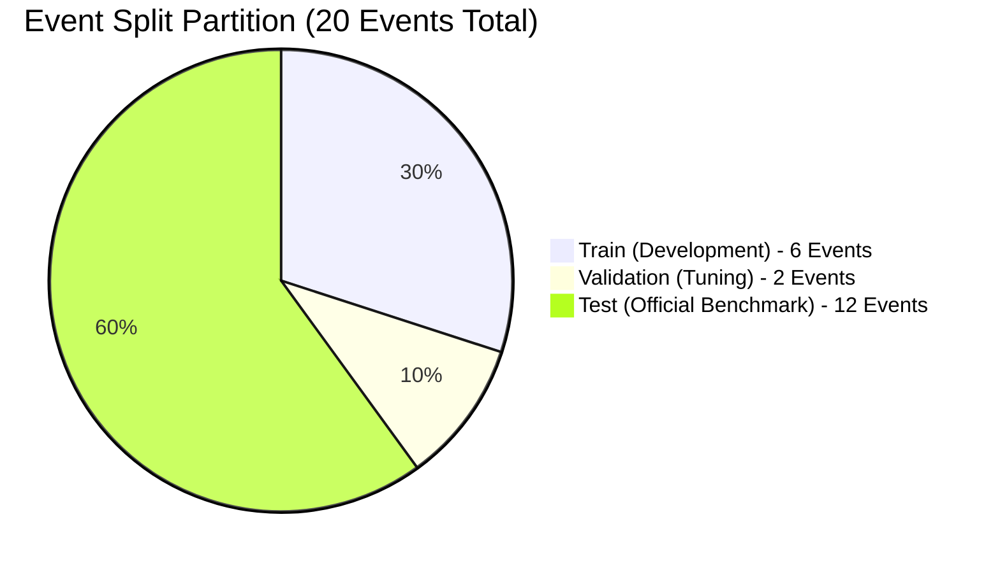

# LarNO Dataset Engineering & Preprocessing Pipeline
**Crestix Probe — Member 1: Dataset Acquisition, Region Selection & Data Engineering Lead**  
**Repository Branch:** `feature/larno-data-pipeline`  
**Target:** Shared ML Foundation for XGBoost (Member 2) and PINO (Member 3) Teams  
**External Storage:** Shared Google Drive (`Crestix Probe Shared / ml_data`)

---

## 1. Overview & Objective

This module establishes the official dataset acquisition, spatial cropping, event-level partitioning, and preprocessing contracts based on the **LarNO UKEA 8 m / 5-minute** urban flood benchmark dataset:
- **Official Dataset:** [holmescao/LarNO-dataset on Hugging Face](https://huggingface.co/datasets/holmescao/LarNO-dataset) (MIT License)
- **Reference Paper:** *Large-scale urban flood modeling and zero-shot high-resolution generalization with LarNO* (*Journal of Hydrology*, 2026)
- **Official Repository:** [holmescao/LarNO on GitHub](https://github.com/holmescao/LarNO)

Both model teams (**XGBoost tabular model** and **PINO Fourier Neural Operator**) ingest this exact same selected spatial crop, train/validation/test split, and normalization parameters.

---

## 2. Dataset Inspection Findings

Prior to pipeline development, the raw UKEA 8m/5min dataset on Hugging Face was comprehensively inspected:

| Property | Value | Notes |
| :--- | :--- | :--- |
| **Catchment Site** | UK Environment Agency (UKEA) | Small urban catchment (~0.40 km²) |
| **Hydrodynamic Engine** | MIKE+ (DHI) | 2D overland flow numerical solver |
| **Grid Cell Resolution** | 8.0 m | Uniform spatial resolution in $x$ and $y$ |
| **Raw Spatial Dimensions** | $50 \times 120$ | 50 rows, 120 columns (6,000 cells) |
| **Selected Crop Dimensions** | $32 \times 32$ | 32 rows, 32 columns (1,024 cells, 256 m × 256 m) |
| **Total Events** | 20 events | 8 official train events, 12 official test events |
| **Event Duration** | 3.0 hours (180 min) | Continuous storm hyetograph simulations |
| **Hydrodynamic Timesteps ($h$)** | 36 steps | 5-minute output cadence ($t \in [0, 35]$) |
| **Raw Rainfall Timesteps** | 360 steps | 30-second hyetograph input (aggregated to 36 steps / 5 min) |
| **DEM Units & Range** | Meters ($m$) | 21.15 m – 40.00 m (0 NaNs in bare-earth grid) |
| **Rainfall Units & Range** | $mm / 5\text{min}$ | 0.00 mm – 3.55 mm/5min (0 NaNs, non-negative) |
| **Water Depth Units & Range** | Meters ($m$) | 0.00 m – 1.91 m (0 NaNs, non-negative overland depth) |

---

## 3. Spatial Crop Selection: Rows [12:44], Cols [32:64]

A $32 \times 32$ spatial crop was selected via systematic sliding-window optimization across all events. It was **not** selected arbitrarily:

```text
Full UKEA Grid: (50 rows x 120 cols)
 0 -------------------------------------------------------------
   | Artificial border wall (elev = 40.0m)                     |
12 |           +-----------------------+                       |
   |           | Selected 32x32 Crop   |                       |
   |           | Rows: [12:44]         |                       |
   |           | Cols: [32:64]         |                       |
   |           | 256m x 256m           |                       |
44 |           +-----------------------+                       |
   |                                                           |
50 -------------------------------------------------------------
   0           32                      64                     120
```

### Empirical Rationale
1. **Hydrological Channel Capture:** Captures the main topographic valley depression and drainage channel where floodwater converges from flanking hillslopes.
2. **Elimination of Artificial Boundaries:** The full UKEA DEM has an artificial border wall at row 0 (elevation clamped to 40.0 m) and boundary zero-padding. Crop `[12:44, 32:64]` avoids boundary edges entirely.
3. **Topographic Variation:** Contains significant elevation gradient (elevation range: 21.68 m – 31.46 m, standard deviation: 1.85 m), providing varied terrain slopes.
4. **Flood Dynamism:** Contains the peak flood depth across the entire UKEA site (1.913 m) and a balanced distribution of wet and dry cells (35.4% to 60.4% wet cells across return periods).
5. **Power-of-2 Fourier Efficiency:** $32 = 2^5$ enables optimal 2D Fast Fourier Transforms (FFT) in Neural Operators (PINO) without periodic zero-padding.

---

## 4. Train, Validation & Test Partition

To strictly preserve generalization benchmarks while preventing data leakage, the official 8 training events were split into **6 train** and **2 validation** events, while preserving all **12 official test events**:



### 4.1 Split Details
- **Train (6 events):**
  - `r100y_p0.1_d3h_1` (100y, peak factor 0.1)
  - `r100y_p0.8_d3h_1` (100y, peak factor 0.8)
  - `r200y_p0.3_d3h_1` (200y, peak factor 0.3)
  - `r300y_p0.1_d3h_1` (300y, peak factor 0.1)
  - `r300y_p0.5_d3h_1` (300y, peak factor 0.5)
  - `r500y_p0.2_d3h_1` (500y, peak factor 0.2 — extreme event)
- **Validation (2 events):**
  - `r100y_p0.5_d3h_1` (100y, mid-peak factor 0.5)
  - `r200y_p0.7_d3h_1` (200y, late-peak factor 0.7)
- **Test (12 events):**
  - `r100y_p0.6_d3h_1`, `r100y_p0.7_d3h_1`
  - `r200y_p0.5_d3h_1`
  - `r300y_p0.4_d3h_1`, `r300y_p0.6_d3h_1`, `r300y_p0.8_d3h_1`, `r300y_p0.9_d3h_1`
  - `r500y_p0.1_d3h_1`, `r500y_p0.3_d3h_1`, `r500y_p0.4_d3h_1`, `r500y_p0.6_d3h_1`, `r500y_p0.9_d3h_1`

**Zero Leakage Guarantee:** Train, Validation, and Test sets have **pairwise empty intersections** ($S_{\text{train}} \cap S_{\text{val}} = \emptyset$, $S_{\text{train}} \cap S_{\text{test}} = \emptyset$, $S_{\text{val}} \cap S_{\text{test}} = \emptyset$).

---

## 5. Normalization Parameters

Normalization constants were computed **strictly on the 6 training events on the $32 \times 32$ spatial crop**:

$$\hat{x} = \frac{x - \mu_{\text{train}}}{\sigma_{\text{train}}}$$

| Variable | Unit | Training Mean ($\mu$) | Training Std ($\sigma$) | Training Min | Training Max |
| :--- | :--- | :--- | :--- | :--- | :--- |
| **DEM** | $m$ | `26.684261` | `1.847113` | `21.684074` | `31.464674` |
| **Rainfall** | $mm / 5\text{min}$ | `0.607498` | `0.627756` | `0.000000` | `3.551322` |
| **Water Depth ($h$)** | $m$ | `0.126487` | `0.223847` | `0.000000` | `1.912649` |

Validation and test sets **must** be normalized using these exact values to prevent test-set distribution leakage.

---

## 6. Shared Contracts for ML Teams

### 6.1 XGBoost Team (Tabular Spatiotemporal Modeling)
- **Input:** Tabular row vectors per pixel and time step:
  - Static: `dem_elevation`, `slope_magnitude`, `curvature`, `row_coord`, `col_coord`
  - Dynamic Forcing: `rain_t`, `rain_t-1`, `rain_t-2`, `rain_cumsum`
  - Lagged Autoregression: `h_t-1`, `h_t-2`
- **Target:** $h(t+1)$ or residual $\Delta h = h(t+1) - h(t)$
- **Evaluation:** RMSE, MAE, Critical Success Index (CSI at thresholds $\tau \in \{0.05\text{m}, 0.15\text{m}, 0.30\text{m}\}$).

### 6.2 PINO Team (Physics-Informed Neural Operator)
- **Input Tensor:** `[Batch, 2, 32, 32, 36]`
  - Channel 0: Static DEM broadcast across time `[B, 1, 32, 32, 36]`
  - Channel 1: Dynamic precipitation `[B, 1, 32, 32, 36]`
- **Target Tensor:** `[Batch, 1, 32, 32, 36]` water depth in meters (or millimetres scaled by $1000.0$)
- **PDE Loss:** 2D Shallow Water Equations evaluated via finite differences with $\Delta x = \Delta y = 8.0\text{ m}$ and $\Delta t = 300\text{ s}$.

---

## 7. Deliverables & File Layout

```text
ml_data/
├── README.md                   # This master documentation
├── data_dictionary.md          # Exhaustive physical variable definitions and formats
├── dataset_manifest.json       # Top-level dataset configuration and training stats
├── split_manifest.json         # Exact 6/2/12 event assignment metadata
├── schemas/
│   └── sample_schema.json     # JSON Schema (Draft-07) for sample validation
├── scripts/
│   ├── inspect_dataset.py      # CLI tool to profile raw and cropped arrays
│   ├── prepare_dataset.py      # Reproducible ETL script (supports --fixture-only)
│   └── validate_dataset.py     # Automated validator checking splits, shapes, and checksums
├── fixtures/
│   └── sample_event/           # Small (~300 KB) self-contained fixture in Git
│       ├── dem.npy             # 32x32 float32 bare-earth elevation
│       ├── rainfall.npy        # 36x32x32 float32 5-min precipitation
│       ├── h.npy               # 36x32x32 float32 water depth ground truth
│       └── metadata.json       # Array shapes, units, and SHA-256 checksums
└── tests/
    └── test_dataset.py         # Pytest test suite (9 tests covering integrity & contracts)
```

---

## 8. Google Drive Storage Structure

Large multi-gigabyte raw and preprocessed arrays are hosted in the **Shared Crestix Probe Google Drive** folder under:

```text
Google Drive: Crestix Probe Shared / ml_data/
├── raw_larno_ukea_8m_5min/
│   ├── geodata/dem.npy
│   └── flood/
│       ├── r100y_p0.1_d3h_1/ {rainfall.npy, h.npy}
│       └── ... (all 20 events)
├── processed_32x32_crops/
│   ├── train/ (6 event folders with dem.npy, rainfall.npy, h.npy)
│   ├── val/   (2 event folders with dem.npy, rainfall.npy, h.npy)
│   └── test/  (12 event folders with dem.npy, rainfall.npy, h.npy)
└── manifests_and_checksums/
    ├── dataset_manifest.json
    ├── split_manifest.json
    └── sha256_checksums.txt
```

---

## 9. Quickstart: Running Tests & Validation

Without downloading the entire dataset, any team member can verify the fixture and contracts locally:

```bash
# 1. Run automated dataset and manifest validation
python ml_data/scripts/validate_dataset.py

# 2. Inspect the canonical sample fixture
python ml_data/scripts/inspect_dataset.py --dir ml_data/fixtures/sample_event

# 3. Run pytest test suite
python -m pytest ml_data/tests/test_dataset.py
```
